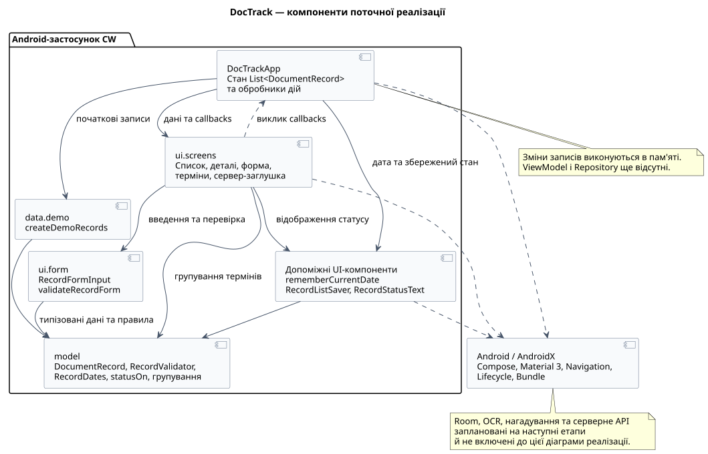
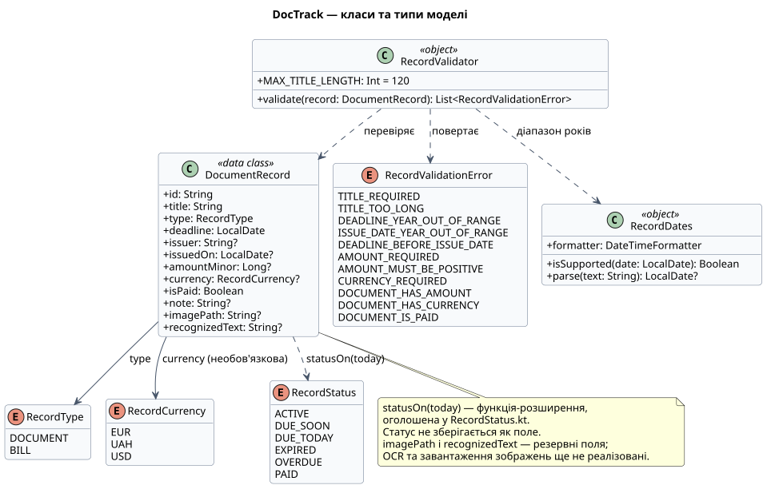
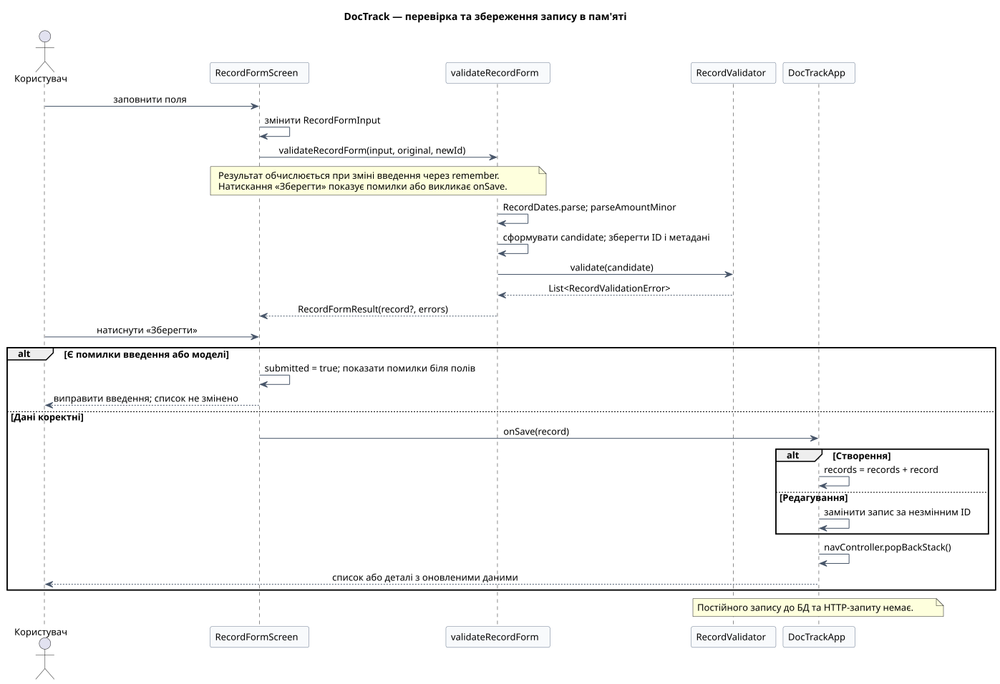
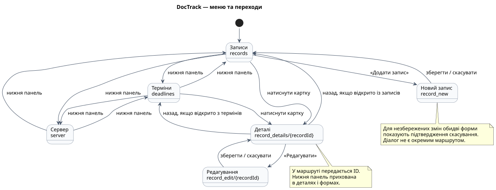

# Проєктування DocTrack: пункти 1–4

Базова версія: [`61cd8905`](https://github.com/Christ1naa/RPZMP/commit/61cd8905eed8a0faa016a609fbacb6a76b74dc7b). Цей документ пояснює рішення для звіту. Сам по собі README або набір діаграм не замінює звіт, який потрібно подати за вимогами Classroom.

## 1. Компоненти, взаємодія та класи

`DocTrackApp` володіє списком записів і `NavController`, створює початкові дані та обробляє додавання й редагування. Екрани одержують значення й callbacks. Модель не залежить від Android: її можна перевіряти звичайними JVM-тестами. `ui.form` перетворює введення на типізовану модель та узгоджує помилки моделі з полями форми.

Допоміжні UI-функції дають спільну локальну дату, відображають статуси та підтримують відновлення малого навчального стану. AndroidX забезпечує компонування, навігацію, lifecycle й механізм saved state. Справжньої локальної БД або мережевого клієнта немає.

Один `DocumentRecord` представляє документ або рахунок; `RecordType` керує застосовністю фінансових полів. Валюта, статус і помилки моделі представлені переліками, щоб уникнути довільних рядкових значень. `RecordValidator` та `RecordDates` — singleton-об’єкти Kotlin. Повна таблиця полів і допоміжних моделей — у [data-model.md](data-model.md).

Після зміни введення форма отримує результат `validateRecordForm`. Перетворення дати/суми та модельні правила перевіряються до зміни списку. За помилок «Зберегти» показує підказки; за успіху callback оновлює список в `DocTrackApp`. Редагування замінює запис за ID, створення додає новий. Повернення виконується через `popBackStack`.

## 2. Структура меню

| Маршрут | Екран | Перехід / призначення |
| --- | --- | --- |
| `records` | `RecordsScreen` | Початкова вкладка: список, деталі, початок додавання |
| `deadlines` | `DeadlinesScreen` | Групування за термінами; перехід у деталі |
| `server` | `ServerScreen` | Пояснення запланованої серверної демонстрації |
| `record_details/{recordId}` | `RecordDetailsScreen` | Пошук запису за ID; перегляд і перехід до редагування |
| `record_new` | `RecordFormScreen` | Порожня форма; після збереження повернення до записів |
| `record_edit/{recordId}` | `RecordFormScreen` | Заповнена форма; після збереження повернення до деталей |

Нижня панель є лише на трьох основних вкладках. Так користувач не переходить на іншу вкладку в обхід підтвердження незбережених змін. Для кнопки форми та системного «Назад» використовується спільна логіка скасування. Якщо ID не знайдено, показується повідомлення з можливістю повернутися.

## 3. Розміщення й стилізація

Material 3 задає типографіку, поверхні й кольори. Нижня панель має підписані векторні іконки документа, календаря та сервера. Картки містять тип, назву, організацію, кінцеву дату, фінансові дані для рахунку й статус. Підпис статусу доповнює колір, тому значення не передається лише кольором.

Заголовок списку, кнопка додавання, повідомлення та картки розміщені в одному `LazyColumn`, щоб великий шрифт не зменшував доступну ділянку списку через нерухомий верх. Порожні стани та екран «Сервер» прокручуються. Заголовки позначені для засобів доступності; поля передають конкретний текст помилки через семантику. Форма вертикально прокручується та враховує клавіатуру. Типи й валюти в `FlowRow` переносяться на наступний рядок; сума, валюта й оплата видимі лише для рахунку. Помилки наведені біля відповідного поля. Рядок «Оплачено» має одну дію перемикання з роллю checkbox. Прапорець без окремого обробника не дублює дію рядка.

Інтерфейс використовує системну світлу/темну тему; на сумісних пристроях — динамічні кольори. Порожні стани, прокручування й підтвердження скасування вже реалізовані. Поточні результати й обмеження підтвердження наведені в [протоколі](verification-results.md), сценарії та скриншоти — у [ui-checks.md](ui-checks.md).

## 4. Моделі та перевірка

Див. [таблицю полів](data-model.md) і [правила моделі](model-rules.md). Точні грошові значення зберігаються в найменших одиницях валюти; дата подана як `LocalDate`, статус обчислюється відносно переданої локальної дати. Форма та модель спільно відхиляють неприпустимі значення.

60 предметних JVM-тестів перевіряють правила й граничні випадки. Окремо користувачка підтвердила Android-збірку, Gradle unit tests, Lint і ручні сценарії. Не слід називати ці 60 тестів UI-тестами або вважати `BUILD SUCCESSFUL` доказом відсутності попереджень Lint.

## Межі першої здачі

Реалізовано проєктування й демонстраційний UI, моделі та правила, операції зі списком у пам’яті. Збереження в Room, ViewModel/Repository, OCR, нагадування та API — наступні етапи. Поля `imagePath` і `recognizedText` наразі лише резервують дані майбутніх функцій.

Для завершення пакета здачі потрібно додати фінальні скриншоти, уточнити титульні реквізити, оформити документ за методичкою та експортувати й перевірити PDF. Оголошення Classroom вимагає ZIP зі звітом і GitHub-посилання під ПІБ на титулі.
