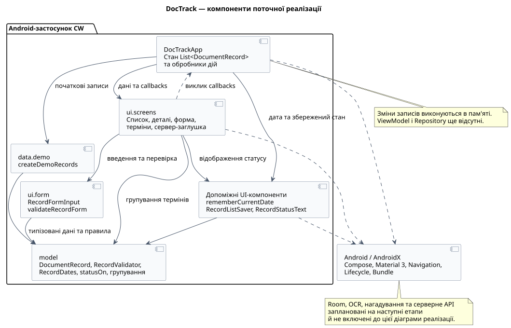
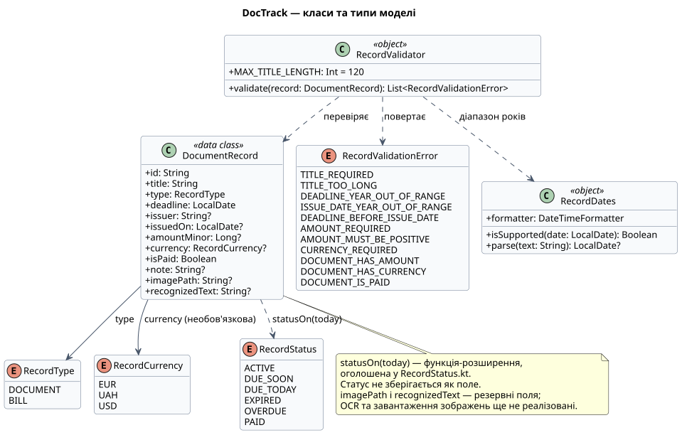
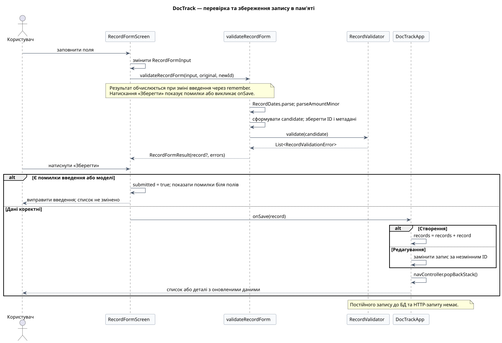
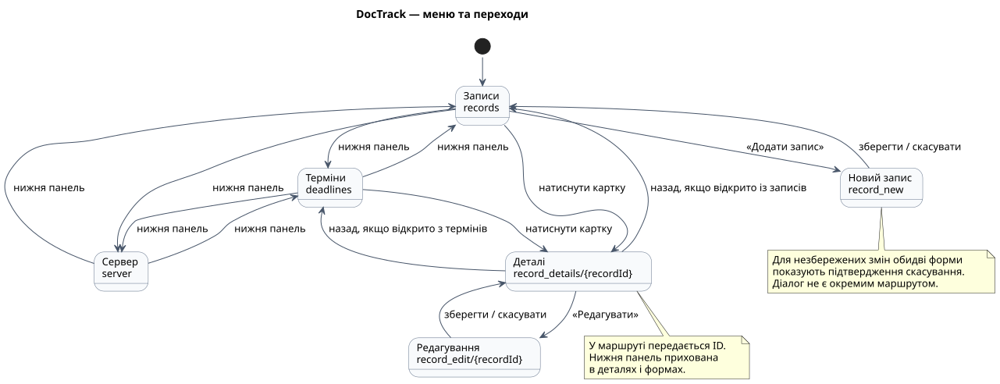

# Чернетка звіту: пункти 1–4 курсової роботи

**Статус:** текстова основа для остаточного документа. Ще потрібні фінальні скриншоти, повний ПІБ і оформлення титулу за методичкою. Цей файл не є готовим ZIP для здачі.

## Титульні відомості

Національний технічний університет України «Київський політехнічний інститут імені Ігоря Сікорського»

Курсова робота з дисципліни «Розробка програмного забезпечення мобільних пристроїв». Проміжний звіт за пунктами 1–4.

Тема: **«Мобільний застосунок для обліку документів, рахунків і термінів їх дії з функцією розпізнавання тексту»**.

Виконала: студентка групи **ТВ-з31**, **Вахрушева Христина — повне по батькові уточнити**.

**GitHub: https://github.com/Christ1naa/RPZMP — проєкт у папці CW.**

Перевірив: **Недашківський Олексій Леонідович**. Реквізити кафедри та шаблон титулу уточнити за методичними рекомендаціями.

Київ — 2026.

## Мета й межі етапу

Розробити структуру Android-застосунку DocTrack, спроєктувати компоненти та моделі даних, реалізувати меню й основні екрани для обліку документів і рахунків. Розглянута версія — 1.0 (1), кодовий коміт `61cd8905eed8a0faa016a609fbacb6a76b74dc7b`.

Застосунок допомагає переглядати реквізити, контролювати кінцеві дати та відрізняти оплачені рахунки від неоплачених. Документ має дату завершення дії, а рахунок — строк оплати та фінансові реквізити. Один користувач працює з навчальним списком у пам’яті. Оплата через банк, облікові записи, автоматична синхронізація та розпізнавання кількох рахунків не реалізовані.

OCR залишається функцією затвердженої теми, яку потрібно виконати на наступних етапах. Її відсутність у поточному прототипі зазначена явно. Подальші етапи також включатимуть постійну БД, нагадування й серверну взаємодію.

## Вимоги, прийняті для прототипу

| ID | Поведінка поточної версії |
| --- | --- |
| F01 | Перегляд списку й деталей документів та рахунків |
| F02 | Додавання і редагування з перевіркою обов’язкових і залежних від типу полів |
| F03 | Обчислення статусу за датою та оплатою; оплачений рахунок має пріоритет |
| F04 | Групування термінів, виключення оплачених рахунків і перехід у деталі |
| F05 | Попередження про втрату незбережених змін |
| Q01 | Відокремлення чистої Kotlin-логіки від Compose для JVM-перевірок |
| Q02 | Відновлення малого навчального стану при відтворенні Activity, включно з поворотом |
| Q03 | Використання теми Material 3, текстових підписів статусу та повідомлень про помилки |

Це опис прийнятих проєктних рішень, а не дослівний перелік вимог викладача. Повну відповідність складу й оформленню звіту потрібно звірити з методичними рекомендаціями.

## 1. Компоненти, взаємодія та класи

`DocTrackApp` володіє списком записів і `NavController`, створює початкові дані та обробляє додавання й редагування. Екрани одержують значення й callbacks. Модель не залежить від Android: її можна перевіряти звичайними JVM-тестами. `ui.form` перетворює введення на типізовану модель та узгоджує помилки моделі з полями форми.

Допоміжні UI-функції дають спільну локальну дату, відображають статуси та підтримують відновлення малого навчального стану. AndroidX забезпечує компонування, навігацію, lifecycle й механізм saved state. Справжньої локальної БД або мережевого клієнта немає.

Один `DocumentRecord` представляє документ або рахунок; `RecordType` керує застосовністю фінансових полів. Валюта, статус і помилки моделі представлені переліками, щоб уникнути довільних рядкових значень. `RecordValidator` та `RecordDates` — singleton-об’єкти Kotlin. Повна таблиця полів і допоміжних моделей — у [data-model.md](data-model.md).

Після зміни введення форма отримує результат `validateRecordForm`. Перетворення дати/суми та модельні правила перевіряються до зміни списку. За помилок «Зберегти» показує підказки; за успіху callback оновлює список в `DocTrackApp`. Редагування замінює запис за ID, створення додає новий. Повернення виконується через `popBackStack`.

## 2. Структура меню

| Маршрут | Екран | Перехід / призначення |
| --- | --- | --- |
| `records` | `RecordsScreen` | Початкова вкладка: список, деталі, початок додавання |
| `deadlines` | `DeadlinesScreen` | Групування за термінами; перехід у деталі |
| `server` | `ServerScreen` | Пояснення запланованої серверної демонстрації |
| `record_details/{recordId}` | `RecordDetailsScreen` | Пошук запису за ID; перегляд і перехід до редагування |
| `record_new` | `RecordFormScreen` | Порожня форма; після збереження повернення до записів |
| `record_edit/{recordId}` | `RecordFormScreen` | Заповнена форма; після збереження повернення до деталей |

Нижня панель є лише на трьох основних вкладках. Так користувач не переходить на іншу вкладку в обхід підтвердження незбережених змін. Для кнопки форми та системного «Назад» використовується спільна логіка скасування. Якщо ID не знайдено, показується повідомлення з можливістю повернутися.

## 3. Розміщення й стилізація

Material 3 задає типографіку, поверхні й кольори. Нижня панель має підписані векторні іконки документа, календаря та сервера. Картки містять тип, назву, організацію, кінцеву дату, фінансові дані для рахунку й статус. Підпис статусу доповнює колір, тому значення не передається лише кольором.

Форма вертикально прокручується та враховує клавіатуру. Типи й валюти в `FlowRow` переносяться на наступний рядок; сума, валюта й оплата видимі лише для рахунку. Помилки наведені біля відповідного поля. Рядок «Оплачено» має одну дію перемикання з роллю checkbox. Прапорець без окремого обробника не дублює дію рядка.

Інтерфейс використовує системну світлу/темну тему; на сумісних пристроях — динамічні кольори. Порожні стани, прокручування й підтвердження скасування вже реалізовані. Поточні результати й обмеження підтвердження наведені в [протоколі](verification-results.md), сценарії та скриншоти — у [ui-checks.md](ui-checks.md).

## 4. Моделі та перевірка

Див. [таблицю полів](data-model.md) і [правила моделі](model-rules.md). Точні грошові значення зберігаються в найменших одиницях валюти; дата подана як `LocalDate`, статус обчислюється відносно переданої локальної дати. Форма та модель спільно відхиляють неприпустимі значення.

60 предметних JVM-тестів перевіряють правила й граничні випадки. Окремо користувачка підтвердила Android-збірку, Gradle unit tests, Lint і ручні сценарії. Не слід називати ці 60 тестів UI-тестами або вважати `BUILD SUCCESSFUL` доказом відсутності попереджень Lint.

## Скриншоти та оформлення рисунків

Діаграми вже мають SVG і редаговані джерела. У кінцевому DOCX/PDF потрібно пронумерувати рисунки й таблиці та додати посилання на них у тексті. Для широких діаграм використовувати альбомну сторінку або адаптоване компонування; перевірити читабельність після експорту.

| Потрібний кадр | Що має підтверджувати | Статус |
| --- | --- | --- |
| Список записів | Іконки, документ/рахунки, різні статуси | Очікується скриншот |
| Деталі документа | Реквізити та відсутність фінансових полів | Очікується скриншот |
| Деталі рахунку | Сума, валюта й оплата | Очікується скриншот |
| Форма документа | Набір загальних полів | Очікується скриншот |
| Форма рахунку | Сума, валюта, оплата | Очікується скриншот |
| Помилки введення | Порожнє поле, неправильна дата або сума | Очікується скриншот |
| Терміни | Групи й відсутність оплаченого рахунку | Очікується скриншот |
| Підтвердження скасування | Захист незбережених змін | Очікується скриншот |
| Темна тема / горизонтальний режим | Вибраний приклад адаптації | Очікується скриншот |

Файли зображень UI до цього документа ще не додані; рисунки або результати, яких немає, не слід підміняти штучними макетами.

## Результати перевірок

У чистому JVM-запуску пройшли 60 предметних тестів. Користувачка локально виконала `:app:assembleDebug`, `:app:testDebugUnitTest` і `:app:lintDebug`; спільний прогін завершився `BUILD SUCCESSFUL in 1m 36s`. Число `51 actionable tasks` означає кількість задач Gradle, а не тестів. Кількість попереджень Lint не встановлена без самого звіту.

Основні ручні перевірки додавання, редагування, валідації, повороту, групування термінів та оновлення дати після повернення з фону підтверджені користувачкою. Таблиця джерел, результатів і обмежень наведена у [verification-results.md](verification-results.md). Її потрібно перенести у фінальний звіт із збереженням розмежування автоматичних і ручних перевірок.

## Висновки

Створено навчальний прототип DocTrack: меню, екрани списку, деталей і спільної форми, групування термінів, моделі й перевірку даних. Підготовлено діаграми компонентів, класів і послідовності та схему навігації. Код використовує точні грошові значення, строгі календарні дати й обчислювані статуси.

Наразі зміни зберігаються в тимчасовому списку; saved instance state підтримує відтворення Activity, але не замінює Room. До наступних етапів належать ViewModel/Repository, Room, зображення й OCR, нагадування та серверне API. Для остаточної здачі цього етапу потрібно завершити скриншоти й оформлення звіту.

## Джерела

1. Матеріали викладача: завдання Classroom «Розробка п. 1–4 курсової роботи», силабус і методичні рекомендації, надані студенткою. Точні бібліографічні реквізити уточнити за оригіналами.
2. Вихідний код DocTrack: [CW, коміт 61cd8905](https://github.com/Christ1naa/RPZMP/tree/61cd8905eed8a0faa016a609fbacb6a76b74dc7b/CW).
3. [Android Developers — Save UI state in Compose](https://developer.android.com/develop/ui/compose/state-saving).
4. [Android Developers — Lifecycle in Jetpack Compose](https://developer.android.com/topic/libraries/architecture/lifecycle).
5. [Android Developers — Accessibility API defaults](https://developer.android.com/develop/ui/compose/accessibility/api-defaults).

## Контроль пакета здачі

- Уточнити повний ПІБ, титульний шаблон і формат документа за методичкою.
- Додати скриншоти, нумерацію й підписи рисунків/таблиць, зміст та фінальні посилання в тексті.
- Посилання на GitHub має бути під ПІБ на титульному аркуші; вказати папку `CW`.
- Експортувати PDF та переглянути всі сторінки.
- Сформувати `CW_1-4_ТВ-з31_ПІБ.zip` з документом звіту. DOCX і PDF включати, якщо методичка не встановлює іншого формату.
- Перевірити доступність GitHub викладачу, відкрити ZIP перед завантаженням у Classroom.
